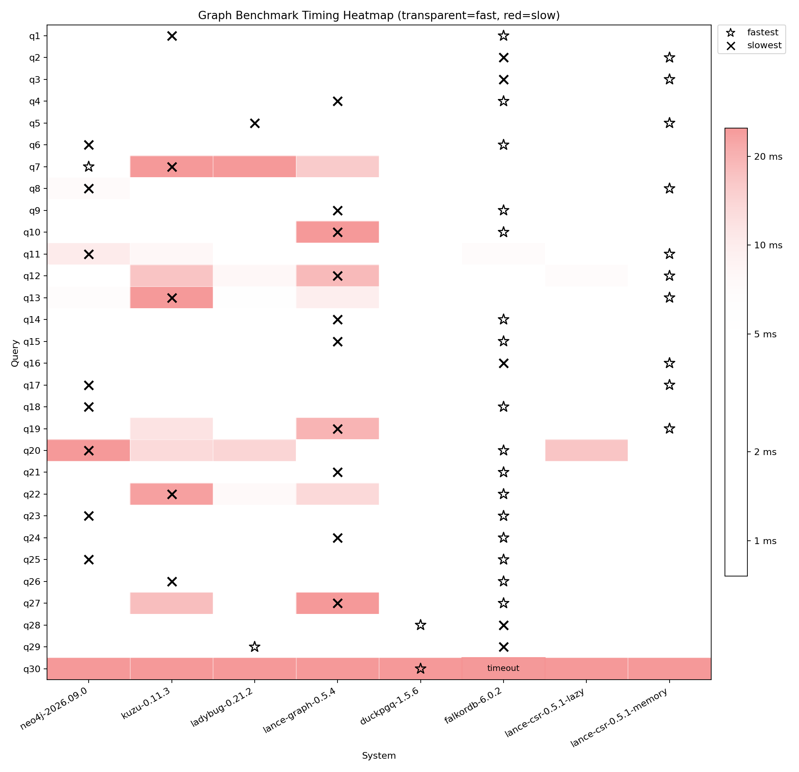

# Graph benchmarks: LDBC SNB SF1

This repo contains a custom graph benchmark using the LDBC Social Network Benchmark (SNB) dataset with a scale factor of 1 (SF1). The dataset is downloaded from [the official source](https://ldbcouncil.org/benchmarks/snb/datasets/). This project complies with [LDBC's fair use policies](https://ldbcouncil.org/benchmarks/fair-use-policies/).

LDBC's policy calls for attribution in accordance with the [Creative Commons Attribution 4.0 International (CC BY 4.0) license](https://creativecommons.org/licenses/by/4.0/). We credit LDBC/GDC for the SNB dataset and data model used here. This repository's original code and custom queries are licensed under [MIT](LICENSE); LDBC materials retain their applicable upstream licenses and are not relicensed under MIT.

The aim of this benchmark is to study and compare the performance of graph systems on an established benchmark dataset. The queries suite run consists of 30 queries that touch various nodes via n-hop path traversals, with very different cardinalities, filters and projections applied to get a more holistic understanding of query performance.

> [!NOTE]
> The query workload was created specifically for this benchmark and is not officially endorsed by LDBC, now known as the Graph Data Council (GDC). This is not an exact re-implementation of an LDBC Benchmark, and the results reported here are not "official" LDBC Benchmark Results.

The following systems are compared:
- Neo4j
- Kuzu (now archived)
- Ladybug
- lance-graph
- DuckPGQ (DuckDB with the SQL/PGQ community extension)
- FalkorDB

## Setup

We use [uv](https://docs.astral.sh/uv/getting-started/installation/) to manage the dependencies.

```sh
# Sync the dependencies locally
uv sync
```
All the dependencies are listed in `pyproject.toml`.

## Dataset

Download the LDBC dataset locally by running the given Python script `download_dataset.py`

```bash
uv run download_dataset.py
```

Alternatively, navigate to the [LDBC site](https://ldbcouncil.org/benchmarks/snb/datasets/) and manually download and unzip the dataset from [this URL](https://datasets.ldbcouncil.org/snb-interactive-v1/social_network-sf1-CsvComposite-StringDateFormatter.tar.zst).

The schema of the LDBC SNB graph is shown below. There are 8 node types and 23 relationship types in the graph.


The individual and total number of nodes and relationships in the graph asre shown below.

```
Node counts:
- Comment: 2052169
- Forum: 90492
- Organisation: 7955
- Person: 9892
- Place: 1460
- Post: 1003605
- Tag: 16080
- Tagclass: 71

Relationship counts:
- commentHasCreator: 2052169
- commentHasTag: 2698393
- commentIsLocatedIn: 2052169
- containerOf: 1003605
- forumHasTag: 309766
- hasInterest: 229166
- hasMember: 1611869
- hasModerator: 90492
- hasType: 16080
- isPartOf: 1454
- isSubclassOf: 70
- knows: 180623
- likeComment: 1438418
- likePost: 751677
- organisationIsLocatedIn: 7955
- personIsLocatedIn: 9892
- postHasCreator: 1003605
- postHasTag: 713258
- postIsLocatedIn: 1003605
- replyOfComment: 1040749
- replyOfPost: 1011420
- studyAt: 7949
- workAt: 21654

Totals:
- nodes: 3181724
- relationships: 17256038
```

In total, there are 3.1M nodes and 17M relationships for the SF1 variant of this dataset.

## Ingest the data as a graph

Navigate to the individual directories to see the instructions on how to ingest the data into each graph system.
Once constructed, the graph is well-connected and has rich relationships between nodes of different types.


## Queries

Navigate to each directory and see the `query.py` files for
each of the 30 queries run in the benchmark.

## High-level results

All six engines were measured on **2026-10-16** on the same machine. The first five ran back to back, and FalkorDB ran later the same day:

| | |
| --- | --- |
| Machine | Apple M5 MacBook Pro (`Mac17,2`), 10 CPU cores (4 performance + 6 efficiency), 24 GiB unified memory |
| OS | macOS 26.6.2 (25G83) |
| Python | 3.13.14, pytest 9.0.2, pytest-benchmark 5.2.3 |
| Embedded engines | Run natively in-process, with no container VM running |
| Neo4j | Docker Desktop (engine 29.8.1), native arm64 Linux VM with 10 CPUs and 19.3 GiB RAM, using the heap/page-cache settings in `neo4j/docker-compose.yml` |
| FalkorDB | Same Docker VM as Neo4j, using `falkordb/docker-compose.yml` (server-side timeouts off, unlimited result set). The idle Neo4j container was still running |

Engine versions:

- **Neo4j 2026.09.0** Community Edition (previously 2025.12.1)
- **Kuzu 0.11.3** (unchanged)
- **Ladybug 0.21.2** (previously 0.21.1). All 30 queries use plain `conn.execute(query)`; `ANALYZE`, result cleanup and the six ART secondary indexes remain enabled
- **lance-graph 0.5.4** (unchanged)
- **DuckPGQ** on DuckDB 1.5.6 (extension build `61f5d082`), new in this run, with the six ART indexes that mirror Ladybug's
- **FalkorDB 6.0.2**, new in this run, running Neo4j's 30 Cypher queries unmodified, with ID indexes plus seven secondary range indexes similar to Ladybug's ART indexes

Every graph was rebuilt from the CSVs before timing and verified to contain 3,181,724 nodes and 17,256,038 relationships. Every engine passed all 30 result assertions, with at least five measured rounds per query, except FalkorDB: its Q30 hit the 10-second query limit, and its other 29 queries passed. These runs compare the stated deployment configurations: Neo4j and FalkorDB run as servers inside a VM, while the others run embedded. The resource limits are not equal and caches are not controlled cold.

### Benchmark settings

Run from each engine directory:

```sh
uv run --frozen pytest benchmark_query.py \
  --benchmark-min-rounds=5 \
  --benchmark-min-time=0.000005 \
  --benchmark-max-time=1.0 \
  --benchmark-timer=time.perf_counter \
  --benchmark-calibration-precision=10 \
  --benchmark-warmup=off \
  --benchmark-warmup-iterations=5 \
  --benchmark-disable-gc \
  --benchmark-sort=fullname
```

Five rounds is a minimum, not an exact count. Query result conversion and printing stay inside the timed functions. Calibration is enabled and warmup is disabled.

Every Neo4j, Kuzu, Ladybug, DuckPGQ and FalkorDB query has a 10-second timeout; set `QUERY_TIMEOUT_SECONDS` to change it. A query that takes longer is treated as broken: it fails with `TimeoutError` instead of being timed, so one bad plan cannot stretch a run of at least five rounds into hours, and `results/compare.py` shows it as `timeout` in the table. The slowest query in the table below takes about one second. Neo4j applies the limit as a transaction timeout, Kuzu and Ladybug use `Connection.set_query_timeout`, DuckPGQ cancels the query from a watchdog thread with DuckDB's `interrupt()`, and FalkorDB passes a per-query `timeout` to `GRAPH.RO_QUERY`. lance-graph 0.5.4 can neither time out nor cancel a query, so it runs without a limit.

### Mean query latency

Times are in milliseconds. The ratio in parentheses is Neo4j mean / engine mean, so a value above 1 means the engine was faster than this Neo4j setup.

| Query | neo4j-2026.09.0 (ms) | kuzu-0.11.3 (ms) | ladybug-0.21.2 (ms) | lance-graph-0.5.4 (ms) | duckpgq-1.5.6 (ms) | falkordb-6.0.2 (ms) |
| --- | ---: | ---: | ---: | ---: | ---: | ---: |
| q1 | 3.144 | 3.255 (0.97x) | 1.002 (3.14x) | 1.399 (2.25x) | 0.978 (3.22x) | 0.440 (7.14x) |
| q2 | 4.659 | 1.582 (2.94x) | 1.169 (3.99x) | 2.295 (2.03x) | 3.450 (1.35x) | 4.682 (1.00x) |
| q3 | 1.595 | 1.610 (0.99x) | 0.778 (2.05x) | 1.945 (0.82x) | 1.120 (1.42x) | 4.420 (0.36x) |
| q4 | 3.111 | 1.073 (2.90x) | 0.368 (8.44x) | 3.021 (1.03x) | 1.545 (2.01x) | 0.215 (14.46x) |
| q5 | 3.506 | 3.990 (0.88x) | 3.976 (0.88x) | 2.045 (1.71x) | 2.014 (1.74x) | 1.211 (2.90x) |
| q6 | 2.523 | 1.045 (2.42x) | 0.787 (3.21x) | 0.724 (3.49x) | 0.554 (4.55x) | 0.193 (13.06x) |
| q7 | 0.907 | 28.761 (0.03x) | 25.458 (0.04x) | 16.588 (0.05x) | 2.666 (0.34x) | 0.649 (1.40x) |
| q8 | 13.512 | 2.798 (4.83x) | 3.520 (3.84x) | 1.607 (8.41x) | 1.825 (7.40x) | 1.801 (7.50x) |
| q9 | 1.620 | 1.912 (0.85x) | 1.329 (1.22x) | 2.326 (0.70x) | 1.158 (1.40x) | 0.235 (6.90x) |
| q10 | 5.111 | 1.602 (3.19x) | 1.564 (3.27x) | 32.575 (0.16x) | 2.728 (1.87x) | 0.201 (25.42x) |
| q11 | 14.937 | 8.925 (1.67x) | 4.077 (3.66x) | 3.272 (4.56x) | 2.690 (5.55x) | 6.742 (2.22x) |
| q12 | 3.712 | 21.028 (0.18x) | 8.101 (0.46x) | 21.668 (0.17x) | 4.340 (0.86x) | 1.125 (3.30x) |
| q13 | 9.454 | 44.763 (0.21x) | 5.699 (1.66x) | 9.785 (0.97x) | 3.382 (2.80x) | 2.522 (3.75x) |
| q14 | 0.829 | 1.762 (0.47x) | 0.892 (0.93x) | 2.497 (0.33x) | 1.439 (0.58x) | 0.204 (4.07x) |
| q15 | 2.706 | 3.031 (0.89x) | 1.104 (2.45x) | 2.170 (1.25x) | 1.295 (2.09x) | 0.226 (11.99x) |
| q16 | 1.450 | 2.047 (0.71x) | 0.999 (1.45x) | 4.190 (0.35x) | 3.400 (0.43x) | 4.415 (0.33x) |
| q17 | 3.608 | 3.164 (1.14x) | 1.721 (2.10x) | 2.392 (1.51x) | 1.365 (2.64x) | 1.199 (3.01x) |
| q18 | 3.718 | 1.477 (2.52x) | 1.195 (3.11x) | 1.894 (1.96x) | 1.047 (3.55x) | 0.628 (5.92x) |
| q19 | 6.824 | 16.762 (0.41x) | 3.150 (2.17x) | 20.963 (0.33x) | 4.327 (1.58x) | 2.129 (3.21x) |
| q20 | 478.576 | 11.640 (41.11x) | 13.610 (35.16x) | 2.975 (160.88x) | 0.956 (500.39x) | 0.455 (1051.24x) |
| q21 | 1.000 | 0.434 (2.31x) | 0.515 (1.94x) | 1.515 (0.66x) | 0.662 (1.51x) | 0.346 (2.89x) |
| q22 | 3.138 | 28.003 (0.11x) | 7.885 (0.40x) | 14.272 (0.22x) | 5.143 (0.61x) | 0.670 (4.69x) |
| q23 | 4.778 | 1.173 (4.07x) | 0.734 (6.51x) | 2.470 (1.93x) | 1.131 (4.22x) | 0.299 (15.99x) |
| q24 | 1.159 | 1.155 (1.00x) | 0.788 (1.47x) | 1.790 (0.65x) | 0.705 (1.64x) | 0.201 (5.76x) |
| q25 | 3.744 | 1.432 (2.61x) | 1.373 (2.73x) | 1.354 (2.77x) | 0.850 (4.41x) | 0.175 (21.36x) |
| q26 | 1.175 | 3.458 (0.34x) | 1.150 (1.02x) | 2.881 (0.41x) | 1.489 (0.79x) | 0.299 (3.93x) |
| q27 | 2.765 | 14.323 (0.19x) | 4.495 (0.62x) | 24.698 (0.11x) | 2.881 (0.96x) | 0.767 (3.60x) |
| q28 | 4.116 | 1.479 (2.78x) | 2.320 (1.77x) | 2.496 (1.65x) | 1.171 (3.52x) | 4.895 (0.84x) |
| q29 | 3.357 | 0.998 (3.36x) | 0.760 (4.42x) | 2.733 (1.23x) | 1.231 (2.73x) | 4.379 (0.77x) |
| q30 | 1255.746 | 149.549 (8.40x) | 92.893 (13.52x) | 38.173 (32.90x) | 26.809 (46.84x) | timeout |



FalkorDB's Q30 shows as `timeout` because it exceeds the 10-second limit. Without the limit it averaged 61.9 s over five rounds on the same M5 ([CLI output](results/archived/falkordb-6.0.2-q30-no-limit.txt)): the current planner pairs every person's comments with all of their posts (about 447M candidate pairs) before checking `replyOfPost`. See the [FalkorDB README](falkordb/README.md#results).
